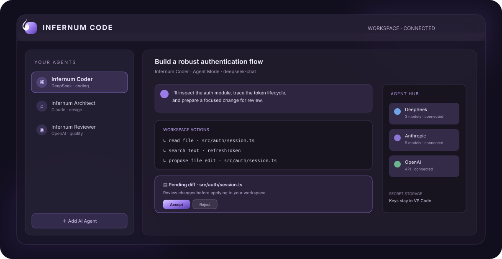

# Infernum AI


**The built-in AI workspace for Infernum IDE, a Code-OSS fork.** Connect a cloud provider or a local model runtime, choose one Primary Model, and let that same model handle architecture, implementation, debugging, tests, review and explanations. Instruction profiles never switch models or delegate work.



## What is included

- **Provider Hub:** DeepSeek, Google Gemini, OpenAI, Anthropic Claude, native Ollama, LM Studio, local OpenAI-compatible runtimes, and HTTPS custom endpoints.
- **Live model discovery:** cloud models and locally installed models are loaded from the provider/server API. A model is suggested from the actual returned list.
- **Streaming:** OpenAI Responses API, DeepSeek/OpenAI-compatible Chat Completions, Gemini `streamGenerateContent`, Anthropic Messages SSE, and Ollama NDJSON chat streaming.
- **Agent Library:** role and instruction profiles (including starter templates), temperature/output settings, duplicate, export and import. Every profile uses the same global Primary Model.
- **Workspace context:** active editor, selected code, Infernum IDE diagnostics and a bounded file inventory are included automatically.
- **Agent Mode:** the model can list/search/read workspace files and prepare full-file proposals. Each proposal opens a diff; accepting it is required before the workspace is modified.
- **Command execution:** shell commands are always shown in a Infernum IDE modal confirmation before execution; execution has a 90-second timeout and bounded captured output.
- **Single-model execution:** one selected provider/model handles every request and every mode. Agent profiles only change the instruction prompt; there is no team orchestration, delegation or hidden model switching.
- **Theme-aware Liquid Glass UI:** uses Infernum IDE theme tokens and supports a per-extension accent/glass setting without modifying editor theme settings.
- **Editor integration:** Activity Bar view, Command Palette commands, selection context actions and keyboard shortcuts.

## Requirements

- Infernum IDE `1.95.0` or newer.
- A cloud provider API key with API access and billing enabled where required, **or** a local model server such as Ollama or LM Studio.
- An open workspace for file inspection and edit proposals.

ChatGPT Plus/Pro subscriptions do **not** include OpenAI API credits. OpenAI API use requires a separate API key and is billed under OpenAI API terms.

## Install

1. Download `infernum-code-0.3.0.vsix` from the project build output.
2. In Infernum IDE, open Extensions → `…` → **Install from VSIX…** and select the package.
3. Or use the command line:

   ```sh
   code --install-extension infernum-code-0.3.0.vsix
   ```

4. Open the **Infernum** Activity Bar view.
5. Choose **Agent Hub → Add AI Agent**, select a cloud or local provider, enter an API key if required, set the server URL for local runtimes, and select **Test connection**. After the model list loads, select **Add AI Agent**.
6. In the Chat toolbar, choose the provider under **Primary Model**. This is the one model Infernum uses for every task. The Agent Library is optional and only changes the instruction profile.

## Provider setup

| Provider | API key | Default Base URL | Model discovery | Generation |
|---|---|---|---|---|
| DeepSeek | Required | Official API | `GET /models` | Chat Completions SSE |
| Gemini | Required | Official API | `GET /v1beta/models` | `streamGenerateContent` SSE |
| OpenAI | Required | Official API | `GET /v1/models` | Responses API SSE |
| Anthropic Claude | Required | Official API | `GET /v1/models` | Messages SSE |
| Ollama | Not required by default | `http://127.0.0.1:11434` | `GET /api/tags` | `POST /api/chat` NDJSON |
| LM Studio | Optional; needed only when server auth is enabled | `http://127.0.0.1:1234/v1` | `GET /models` | `/chat/completions` SSE |
| Local OpenAI-compatible | Optional; depends on server auth | `http://127.0.0.1:8000/v1` | `GET /models` | `/chat/completions` SSE |
| Custom remote | Required | Your HTTPS endpoint | `GET {baseUrl}/models` | `POST {baseUrl}/chat/completions` SSE |

### Ollama (native local API)

1. Install Ollama from [ollama.com/download](https://ollama.com/download) and start the Ollama application/service.
2. Download at least one chat/instruct model in a terminal. Example:

   ```sh
   ollama pull qwen2.5-coder:7b
   ollama list
   ```

   The model name shown by `ollama list` is what Infernum will discover. Use any model you have installed; the example is not a required model.
3. Make sure the local API is available at `http://127.0.0.1:11434`. On systems where Ollama is not already running as a service, start it with `ollama serve`.
4. In Infernum IDE, open **Infernum → Agent Hub → Add AI Agent** and choose **Ollama (local)**.
5. Keep the URL as `http://127.0.0.1:11434` unless you changed Ollama's host/port. Leave **API Key** blank for a standard local Ollama installation.
6. Press **Test connection**. Infernum reads `/api/tags`, shows installed models, then select one and click **Add AI Agent**.
7. Return to Chat and select this connection under **Primary Model**. The same local model now handles Chat, Agent, Code, Debug, Explain, Plan and Review.

Ollama uses its native `/api/chat` stream. The Extension Host parses newline-delimited JSON chunks and forwards tokens as they arrive.

### LM Studio

1. Install and open [LM Studio](https://lmstudio.ai/).
2. Download a chat/instruct model in the Discover area and load it if your version requires manual loading.
3. Open the **Developer** tab and start the **Local Server**. The default address is `http://localhost:1234`.
4. In **Infernum → Agent Hub → Add AI Agent**, choose **LM Studio (local)**.
5. Use Base URL `http://127.0.0.1:1234/v1` (or the host/port you configured). Leave API Key blank unless you enabled API-token authentication in LM Studio's server settings.
6. Press **Test connection**. Infernum reads `/v1/models`; choose the exact model ID returned by LM Studio and click **Add AI Agent**.
7. Select the connection as **Primary Model** in Chat.

LM Studio's OpenAI-compatible routes are used, so no cloud OpenAI account or key is involved.

### Other local OpenAI-compatible servers

Choose **Local OpenAI-compatible** for servers that expose both `GET /v1/models` and `POST /v1/chat/completions`, such as compatible vLLM, LocalAI, llama.cpp server, Jan or other OpenAI-compatible runtimes. Confirm that your server implements streaming Chat Completions; protocol compatibility differs between products and versions.

Example vLLM start command (run in the environment where vLLM is installed):

```sh
vllm serve Qwen/Qwen2.5-Coder-7B-Instruct --host 127.0.0.1 --port 8000
```

Then add a **Local OpenAI-compatible** connection with Base URL `http://127.0.0.1:8000/v1`. If your server requires an API token, paste it in API Key; otherwise leave that field empty. Test the connection and choose the model ID returned by `/v1/models`.

#### LocalAI

LocalAI's official quickstart exposes an OpenAI-compatible API on port `8080`. Install LocalAI using its [installation guide](https://localai.io/docs/getting-started/), start a model (for example `local-ai run qwen3-4b`), then add **Local OpenAI-compatible** with Base URL `http://127.0.0.1:8080/v1`. If you start LocalAI with `LOCALAI_API_KEY`, paste the same value into Infernum's API Key field.

#### llama.cpp server

Start the server with a local GGUF model file:

```sh
llama-server -m /path/to/model.gguf --host 127.0.0.1 --port 9931
```

Add **Local OpenAI-compatible** with Base URL `http://127.0.0.1:9931/v1`. This is the default llama.cpp server address; change the port in Infernum if you started the server on another one.

For any other local runtime, the Base URL must be the API root. If the server URL is `http://localhost:PORT/v1`, enter that exact URL including `/v1`; do not append `/models` or `/chat/completions` yourself. For servers that do not expose `/v1/models`, enter the exact model ID in the manual model field (where available); Infernum checks it with a small test generation request.

### Troubleshooting local connections

- **Connection refused:** start the local server and confirm its port. Test `http://127.0.0.1:11434/api/tags` for Ollama or `http://127.0.0.1:1234/v1/models` for LM Studio in a browser or with `curl`.
- **No models found:** download a model first, load it if the runtime requires that, and repeat **Test connection**.
- **Unknown model:** use the model identifier exactly as returned by the server, including tags or namespaces.
- **401 Unauthorized:** leave the key blank only when server authentication is disabled; otherwise enter the local server's token.
- **Agent Mode does not follow tool instructions reliably:** try a stronger instruct/coder model, verify that the runtime has the correct chat template, and consider increasing `infernum.maxAgentSteps`. Small local models may chat successfully but be less reliable at multi-step code-agent protocols.

The local APIs are called by the Infernum IDE Extension Host, not the WebView. Standard loopback HTTP is supported. HTTP to a private network address is also supported for intentionally hosted local servers; use only on a trusted network because plain HTTP does not encrypt traffic. Public non-private endpoints must use HTTPS.

## Agent modes

- **Chat:** streamed conversation with workspace context.
- **Agent Mode (default):** one model runs the iterative inspect/search/read/propose workflow; proposal changes remain pending until accepted.
- **Code:** implementation-oriented response.
- **Debug:** root-cause analysis and test-driven debugging.
- **Explain:** code walkthrough without changes.
- **Plan:** phased plan with risks and checks.
- **Review:** findings-first review.

All modes use the same Primary Model. The selected instruction profile is passed as an additional system instruction, but it cannot select a different provider/model or delegate to another model.

### Agent Mode tools

The agent can use `list_files`, `read_file`, `search_text`, `propose_file_edit`, and `run_command`. The first four are constrained to workspace paths and bounded output. `propose_file_edit` creates a diff proposal rather than writing directly. `run_command` is always confirmed by a modal prompt. The agent loop is bounded by `infernum.maxAgentSteps`.

When accepting an existing-file proposal, Infernum checks that the file content still matches the version used to prepare the diff. If it changed, the proposal is not applied; ask the agent to prepare a fresh diff.

## Security model

- API keys are stored in Infernum IDE `SecretStorage`; provider metadata only (name, kind, model, base URL) is stored in extension state.
- Keys are not included in agent exports and are not rendered back into the WebView.
- Provider API calls are made in the Extension Host, not directly from the WebView.
- The WebView uses a restrictive Content Security Policy and does not need network access.
- Cloud/custom remote endpoints require HTTPS. Local runtime HTTP is accepted only for localhost or private-network addresses; prefer loopback or HTTPS for remote hosts.
- File paths are resolved relative to the first workspace folder, checked against path traversal, and symbolic links are withheld from file tools.
- File proposals require explicit acceptance; command execution requires explicit confirmation.
- No account login scraping, subscription bypass or unofficial authorization methods are used.

## Build from source

```sh
npm install
npm run compile
npm test
npm run package
```

`npm run package` creates `infernum-code-0.3.0.vsix`. The package script assembles a VSIX archive without bundling development dependencies. The extension host is TypeScript compiled; the WebView currently uses a small dependency-free JavaScript/CSS UI so the extension remains installable without a runtime framework bundle.

## Commands

| Command | Description |
|---|---|
| `Infernum AI: Open` | Open the Infernum view |
| `Infernum AI: Add AI Agent` | Open Agent Hub |
| `Infernum AI: Ask Infernum` | Ask about selected code or enter a prompt |
| `Infernum AI: Fix with Infernum` | Investigate selection in Agent Mode |
| `Infernum AI: Explain with Infernum` | Explain selected code |
| `Infernum AI: Refactor with Infernum` | Prepare refactoring diff proposals |
| `Infernum AI: Stop Agent` | Cancel the current generation |
| `Infernum AI: Import Agent` / `Export Agent` | Import/export a credential-free JSON profile |

## Current scope and limitations

This is a working release, not a claim that every item in the original product brief is complete. The WebView is dependency-free rather than React/Vite-based; markdown rendering is deliberately minimal. Agent tool use is driven by a constrained action-block protocol rather than provider-native function/tool calling. There is deliberately no multi-agent orchestration: one Primary Model owns every task. There is no online marketplace, OAuth account integration, Infernum IDE integrated-terminal output stream, multi-root per-agent permission matrix, file deletion tool, or generic custom auth-header editor. Local providers currently support Ollama native chat and OpenAI-compatible streaming chat; arbitrary local protocols are not supported unless the runtime exposes the documented compatible routes. Provider requests are text-oriented; multimodal file/image inputs are not implemented. The VSIX can be assembled in a system with Node.js and `zip`; interactive installation must be verified in a local Infernum IDE instance.

## Official API references

- [DeepSeek API – List Models](https://api-docs.deepseek.com/api/list-models/)
- [DeepSeek API – Chat Completions](https://api-docs.deepseek.com/api/create-chat-completion/)
- [Gemini API – Models](https://ai.google.dev/api/models)
- [Gemini API – Generate Content](https://ai.google.dev/api/generate-content)
- [OpenAI API – Models](https://developers.openai.com/api/docs/models)
- [OpenAI API – Streaming Responses](https://developers.openai.com/api/docs/guides/streaming-responses)
- [Anthropic API – List Models](https://platform.claude.com/docs/en/api/models/list)
- [Anthropic API – Streaming Messages](https://platform.claude.com/docs/en/build-with-claude/streaming)
- [Ollama API – List models](https://docs.ollama.com/api/tags)
- [Ollama API – Chat](https://docs.ollama.com/api/chat)
- [LM Studio – Local API Server](https://lmstudio.ai/docs/developer/core/server)
- [LM Studio – OpenAI-compatible endpoints](https://lmstudio.ai/docs/developer/openai-compat)
- [vLLM – OpenAI-compatible serving](https://docs.vllm.ai/en/stable/serving/openai_compatible_server/)
- [LocalAI – Quickstart and OpenAI-compatible API](https://localai.io/docs/getting-started/)
- [llama.cpp – HTTP Server](https://github.com/ggml-org/llama.cpp/blob/master/tools/server/README.md)
- [Infernum IDE Extension API](https://code.visualstudio.com/api/references/vscode-api)
- [Infernum IDE Webview guidance](https://code.visualstudio.com/api/ux-guidelines/webviews)

## License

MIT. See [LICENSE](LICENSE).
